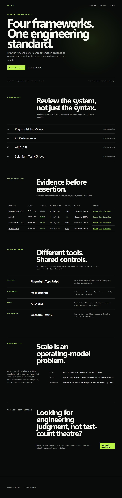

# Organization profile and portfolio dashboard

This repository owns the default community-health files, organization profile,
and generated portfolio dashboard for
[`qa-test-automation-frameworks`](https://github.com/qa-test-automation-frameworks).

## Reviewer proof

| Evidence | Link |
| --- | --- |
| Portfolio dashboard | [Scheduled evidence dashboard](https://qa-test-automation-frameworks.github.io/.github/) |
| Organization profile | [Profile source](profile/README.md) |
| Repository matrix | [Machine-readable source](portfolio/repositories.json) |
| Dashboard assets | [Site source](site) |
| CI | [Dashboard workflow](https://github.com/qa-test-automation-frameworks/.github/actions/workflows/dashboard.yml) |

The dashboard refresh workflow reads public GitHub metadata and durable evidence records and writes a
timestamped, pre-rendered snapshot that remains complete without JavaScript. It separates execution
from publication, shows the latest attempt and last success, checks source compatibility and declared
freshness, and displays known limitations. It does not claim private adoption, production usage, or
organizational outcomes that cannot be independently verified. See the
[Portfolio Evidence Standard](docs/PORTFOLIO_EVIDENCE_STANDARD.md) and the
[dashboard evidence-state and refresh-health notes](docs/verification/2026-10-16-dashboard-evidence-state.md).
The proposed shared reference target is defined in
[ADR 007](docs/adr/007-shared-reference-application.md); it is a design decision,
not a claim that the application or integrations exist yet.

`site/data/portfolio.json` in this checkout is a committed seed snapshot for local rendering
and testing, not the live evidence record. The scheduled workflow regenerates the deployed
version on GitHub Pages; check `generatedAt` in the deployed file, not this one, for current
freshness.



## Local first success

Use Node.js 24.21.0 from `.nvmrc`, then run:

```sh
node --test scripts/dashboard.test.mjs scripts/evidence-contract.test.mjs
node scripts/validate-dashboard.mjs
```

These scripts use Node's standard library; no npm install, credentials, network
or browser is needed for this stored-snapshot check. Repeat the same commands
after editing. The committed snapshot may correctly warn that it is stale; this
path checks its contract and fallback, not current live evidence. Refreshing with
`node scripts/refresh-dashboard.mjs` separately needs a read token in GITHUB_TOKEN
and network access. CI selects `.nvmrc`; a stable later Node24 patch/minor is
allowed but not automatically verified. Unsupported runtimes fail before token
or snapshot handling with a setup instruction.

The version3 [evidence contract](docs/PORTFOLIO_EVIDENCE_STANDARD.md) is validated
locally and by the documentation workflow. It separates native execution, artifact
publication and historical attestations. Framework emitters and the central publisher
are implemented on the roadmap branch, while end-to-end public publication remains
unverified; synthetic fixtures are contract controls, not framework execution proof.
GitHub currently reports the dashboard workflow disabled for inactivity, so the
committed snapshot is intentionally unavailable until a default-branch refresh runs.
